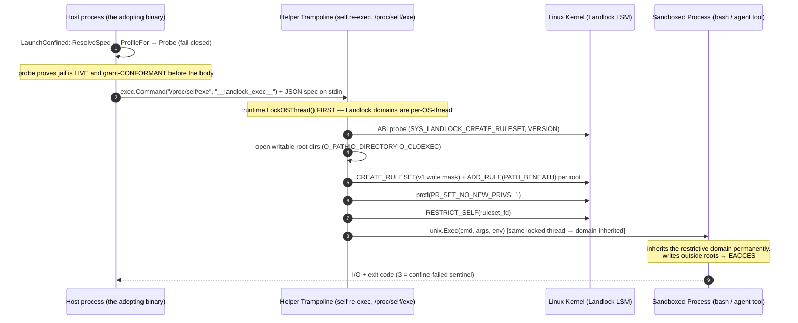

# Implementation Plan: Linux Landlock Containment Parity for Shepherd Go

> **Status: implemented.** This plan defines and ships the Linux containment
> axis — the `ContainmentBackend` contract, the fail-closed probe, the error
> taxonomy, the `may=`/grant lowering, the placement model, and authority
> evidence — as a self-contained component (module boundary in §15). Host
> integration (`yaah`, `croft`) is deferred (§10.3). Implementation status and
> deviations are in §16; the overall roadmap is `README.md`.

## 1. Objective & Context

The backlog trigger is recorded in
[`shepherd-kernel-go/docs/DEVELOPMENT.md`](file:///home/greg/Code/Agentic/Frameworks/shepherd-kernel-go/docs/DEVELOPMENT.md#L71):

> *"Landlock exec-wrapper for git-sandbox Exec (Linux): a `JailedExec` option on
> `SandboxSpec` would bring OS enforcement to the portable backend. Trigger: a
> consumer runs untrusted code without containerd."*

The same item, with the fuller framing, is in
[`shepherd-kernel-go/docs/history/parity-plan.md`](file:///home/greg/Code/Agentic/Frameworks/shepherd-kernel-go/docs/history/parity-plan.md#L198)
§5, and the "Path B — OS-level enforcement (fenced)" discussion is in
[`00-execution-plan.md`](file:///home/greg/Code/Agentic/Frameworks/shepherd-kernel-go/docs/history/00-execution-plan.md#L726).

Current state:

1. **`croft`** — the successor to the runtime's former `sandbox/containerd`
   nested module, now its own module — provides heavy container containment on
   Linux via `containerd` (namespaces, cgroups v2, OverlayFS snapshots). It is
   **out of scope here**: Landlock is the lightweight, host-native tier that
   complements it, not replaces it.
2. **`GitSandbox`** ([`shepherd-runtime-go/sandbox/git/backend.go`](file:///home/greg/Code/Agentic/Frameworks/shepherd-runtime-go/sandbox/git/backend.go))
   manages worktrees and repository state; its `Exec()` currently returns
   `sbx.ErrUnsupported` (`backend.go:585`), `ReadFile`/`WriteFile` likewise.
3. Running local agent commands directly on the host is **uncontained**. This
   component is the fix; pointing a specific host (e.g. `yaah`'s local workspace)
   at it is a **later, separate step** (§15).
4. The Go port has **no** authority layer at all: no `may=` profile, no
   per-binding grants, no `ConfinementSpec`, no monitor assignment. The parity
   plan records this as deliberately out of scope
   ([`parity-plan.md:120`](file:///home/greg/Code/Agentic/Frameworks/shepherd-kernel-go/docs/history/parity-plan.md#L120)).

**Goal:** bring the kernel-enforced filesystem jail to the lightweight
Git-worktree path *and* the contract that makes it a policy-enforcement surface,
so the component can honestly claim parity with Python Shepherd's **Linux host
containment tier** — unprivileged, no root, no containerd daemon — as a
**self-contained module** that hosts and container tiers integrate with later.

## 2. What "Parity" Means Here (the reference surface)

Parity is defined against the Python implementation in
`shepherd/vcs-core/packages/core/src/vcs_core/` and
`shepherd/shepherd/packages/dialect/src/shepherd_dialect/`. The implemented
containment backends there are **Seatbelt** (macOS) and **Landlock** (Linux) —
there is no `_seccomp_containment.py`, no container/VM/AppContainer backend (the
family doc names them as signposted, not built). Therefore:

- **Linux host containment parity == Landlock parity.**
- macOS Seatbelt parity is **out of scope** for the Go port (matches the fence
  in `parity-plan.md`).
- The egress/network axis is a *separate* axis; the jail is host-blind and never
  reads it (`_execution_capability.py:82-88`). Its enforcement is out of scope,
  but its **spec shape must ship** for the lowering to be complete.

## 3. Parity Scope & Explicit Non-Goals

| Python component | File | Go target | In scope? |
|---|---|---|---|
| `ContainmentBackend` Protocol (`name`, `enforcement_tier`, `available`, `profile_for`, `probe`, `launch`) | `_containment.py` | `sandbox/containment` package | ✅ |
| Error taxonomy (`SandboxError`, `SandboxDenied`, `JailNotEstablished`) | `_containment.py:31-46` | `sandbox/containment` sentinels | ✅ |
| `LandlockContainmentBackend` + raw syscalls + trampoline | `_landlock_containment.py` | `sandbox/landlock` nested module (§15) | ✅ |
| `ConfinementSpec`, `NetworkPolicy`, `NetMode`, `_resolve_spec`, `UnsupportedConfinementSpecError` | `_execution_capability.py:74-158` | `sandbox/containment` | ✅ |
| `ExecutionCapability.launch_confined` (resolve → profile → probe → launch) | `_execution_capability.py:183-195` | `containment.LaunchConfined` | ✅ |
| `detect_containment_backend` | `_execution_capability.py:276-288` | `containment.Detect` | ✅ |
| `may=` lowering (`resolve_may`, `MayResolution`, `lower_may_to_confinement`, `UnsupportedMayProfileError`) | `dialect/confinement.py` | `sandbox/confinement` | ✅ |
| Per-binding grants (`BindingRootGrant`, `lower_grants_to_confinement`, `validate_disjoint_roots`, `OverlappingBoundRootsError`, alias/nesting guard) | `dialect/confinement.py` | `sandbox/confinement` | ✅ |
| Monitor assignment (`PermissionPlan`, `JAIL_MONITOR`, `CARRIER_MONITOR`, digest evidence) | `dialect/permission_plan.py` | `sandbox/confinement` (minimal) | ✅ (minimal) |
| Placement (`jail` / `advisory` / `auto`) | dialect docs / placements | `sandbox/confinement` | ✅ |
| `ExecutionAuthorityRequired` negotiation guard | `_execution_capability.py:62-71, 227-273` | `containment` | ✅ (shape) |
| macOS Seatbelt backend | `_seatbelt_containment.py` | — | ❌ non-goal |
| Container / VM / AppContainer containment backends | (signposted) | `croft` (separate module) | ❌ non-goal |
| Egress broker *enforcement* | `_egress_broker.py` | future / `croft` | ❌ non-goal (spec only) |
| `croft` containerd tier | — | separate module | ❌ non-goal (integration deferred, §15) |
| Host integration (`yaah` call sites, session wiring) | — | — | ❌ deferred (§10.3, §15) |

**This component only.** Every in-scope row ships inside the containment
component described in §15. No `yaah` change and no `croft` change is part of
this plan; a host or container tier integrates with the component later.

**The fence.** `00-execution-plan.md:726-732` says Path B "must not [be ported]
by accident" and requires a written decision. This plan *is* that written
decision for the Linux Landlock member: it is scoped, gated, and fail-closed. On
completion, the corresponding backlog entries
(`DEVELOPMENT.md:71`, `parity-plan.md:198`, and the `parity-plan.md:120` "out of
scope" row) must be updated so the fence reflects reality.

## 4. Parity Map (completion checklist)

Each row is a symbol that must exist in Go for parity; the test column names the
conformance test that proves it. This is the objective definition of "done."

Each row is a symbol that must exist in Go for parity; the test column names the
conformance test that proves it. This is the objective definition of "done."

| # | Python symbol | Go symbol (as built) | Test | Done |
|---|---|---|---|---|
| 1 | `ContainmentBackend` | `containment.Backend` (interface) | exercised by every backend test (`fakeBackend`, `landlock`) | ✅ |
| 2 | `SandboxDenied` | `containment.ErrSandboxDenied` (+ `DeniedExit`/`DenyError`) | `TestDeniedExit_ClassifiesSyscallDenial`, `TestLandlock_DeniedClassified` | ✅ |
| 3 | `JailNotEstablished` | `containment.ErrJailNotEstablished` | `TestLandlock_ProbeCatchesMisloweredWritable`, `TestLaunchConfined_*` | ✅ |
| 4 | `landlock_abi` | `landlock.ABI()` | `TestLandlock_ABIDetection` | ✅ |
| 5 | `_WRITE_ACCESS` (v1 mask) | `landlock.WriteAccessMask` | `TestLandlock_MaskIsV1Compatible` | ✅ |
| 6 | `landlock_confine` | `landlock.Confine(roots)` | `TestLandlock_ConfineDeniesOutside` | ✅ |
| 7 | `_run_confined` (sentinel) | `landlock.MaybeRunTrampoline` | `TestLandlock_TrampolineDispatch` | ✅ |
| 8 | `profile_for` | `(*landlock.Backend).ProfileFor` | `TestLandlock_ProfileForParity` | ✅ |
| 9 | `probe` (exit-code aware) | `(*landlock.Backend).Probe` | `TestLandlock_ProbePassesForConformant`, `TestLandlock_ProbeCatchesMisloweredWritable`, `TestLandlock_PerBindingDenyClosed` | ✅ |
| 10 | `launch` | `(*landlock.Backend).Launch` | `TestLandlock_ConfineDeniesOutside`, `TestLaunchConfined_ProbesFirst` | ✅ |
| 11 | `ConfinementSpec` | `containment.ConfinementSpec` | `TestReadOnlyAndPermissiveSpecs` | ✅ |
| 12 | `NetworkPolicy` / `NetMode` | `containment.NetworkPolicy` / `NetMode` | `TestResolveSpec_BrokerRefuses` | ✅ |
| 13 | `_resolve_spec` | `containment.ResolveSpec` | `TestResolveSpec_CanonicalizesRoots` | ✅ |
| 14 | `launch_confined` | `containment.LaunchConfined` | `TestLaunchConfined_ProbesFirst` | ✅ |
| 15 | `detect_containment_backend` | `landlock.Detect` (relocated, §16.2 #3) | `TestDetect_MatchesAvailability` | ✅ |
| 16 | `resolve_may` / `MayResolution` | `confinement.ResolveMay` / `MayResolution` | `TestResolveMay_DefaultPermissive` | ✅ |
| 17 | `lower_may_to_confinement` | `confinement.LowerMay` | `TestLowerMay_ReadOnlyPermissive` | ✅ |
| 18 | `UnsupportedMayProfileError` | `confinement.ErrUnsupportedMayProfile` | `TestLowerMay_RefusesUnknown` | ✅ |
| 19 | `BindingRootGrant` + `lower_grants_to_confinement` | `confinement.BindingRootGrant` / `LowerGrants` | `TestLowerGrants_ReadOnlyContributesNothing` | ✅ |
| 20 | `validate_disjoint_roots` + alias/nesting guard | `confinement.ValidateDisjointRoots` | `TestValidateDisjointRoots_NestingRejected`, `_AliasRejected`, `_UnicodeAliasRejected` | ✅ |
| 21 | `OverlappingBoundRootsError` | `confinement.ErrOverlappingBoundRoots` | (row 20) | ✅ |
| 22 | `PermissionPlan` + `JAIL_MONITOR` digest | `confinement.PermissionPlan` / `Evidence` | `TestPermissionPlan_DigestStable` | ✅ |
| 23 | placement `jail`/`advisory`/`auto` | `confinement.Placement` | `TestPlacement_AutoResolves` | ✅ |
| 24 | `ExecutionAuthorityRequired` | `containment.ErrExecutionAuthorityRequired` | `TestNegotiation_RefusesWithoutCapability` | ✅ |

## 5. Architecture

### 5.1 Two seams, exactly as Python splits them

Python splits the axis cleanly: the **contract + backend** live in `vcs-core`
(`_containment.py`, `_landlock_containment.py`), while the **`may=`/grant
lowering** lives in the dialect (`confinement.py`, `permission_plan.py`). The Go
port mirrors this:

```
shepherd-runtime-go/                      # ROOT MODULE — kernel + stdlib only
├── sandbox/
│   ├── containment/            # the contract (mirrors _containment.py + the spec half of _execution_capability.py)
│   │   ├── backend.go          #   Backend interface, errors, Detect
│   │   ├── spec.go             #   ConfinementSpec, NetworkPolicy, NetMode, ResolveSpec
│   │   └── confined.go         #   LaunchConfined, Capability
│   ├── confinement/            # the authority lowering (mirrors dialect/confinement.py + permission_plan.py)
│   │   ├── may.go              #   ResolveMay, MayResolution, LowerMay, LowerGrants, BindingRootGrant
│   │   ├── disjoint.go         #   ValidateDisjointRoots, alias/nesting guard
│   │   ├── plan.go             #   PermissionPlan, monitors, digest
│   │   └── placement.go        #   Placement
│   └── landlock/               # NESTED MODULE (mirrors _landlock_containment.py) — own go.mod (§15)
│       ├── go.mod              #   requires golang.org/x/sys (direct) + the root runtime
│       ├── syscall_linux.go    #   ABI, WriteAccessMask, Confine (raw syscalls) — private mechanism
│       ├── syscall_other.go    #   //go:build !linux — ErrUnsupportedKernel
│       ├── backend.go          #   Landlock backend: ProfileFor/Probe/Launch
│       ├── trampoline.go       #   MaybeRunTrampoline
│       └── *_linux_test.go     #   privileged container target
```

The raw syscall engine is private mechanism (raw syscalls, no policy) **inside the
nested `landlock` module**; `sandbox/containment` is the public contract;
`sandbox/landlock` is the public backend, split into its own module so the root
runtime keeps its "kernel + stdlib only" footprint (§15). This keeps "one file,
one concern" and makes a future second backend (the seam the original plan
lacked) a drop-in.

### 5.2 The confine-then-exec trampoline (corrected)

The trampoline is a confine-then-exec helper. Two details are load-bearing for
correctness on the Go runtime:



Two correctness requirements:

1. **`runtime.LockOSThread()` is mandatory.** A Go process is multi-threaded and
   Landlock domains are attached to a single `task_struct`. Without pinning, the
   goroutine can be rescheduled between `RESTRICT_SELF` and `unix.Exec`, and the
   exec lands on an **unrestricted** thread — the jail silently evaporates.
2. **Re-exec via `/proc/self/exe`, not `os.Args[0].`** `os.Args[0]` may be
   relative or resolved through `PATH`; `/proc/self/exe` is the running image.

Also, Go has no `python -m <module>` entry point, so the sentinel must be handled
by the `main()` of **every binary that spawns confined processes** (and each
test package's `TestMain`) via `landlock.MaybeRunTrampoline(os.Args)`:

```go
// In any binary that spawns confined processes — and in the TestMain of each
// package whose tests exercise Launch. Within this plan that is the runtime's
// own test binaries; a host binary adds the same line when it adopts the
// component later (§15).
func main() {
    if code, handled := landlock.MaybeRunTrampoline(os.Args); handled {
        os.Exit(code)
    }
    // ... the binary's real work
}
```

This is a required integration point with a documented failure mode: a binary
that forgets the hook makes every `Launch` fail with the confine-failed sentinel
(rc 3), which the probe turns into `ErrJailNotEstablished` — fail-closed, never
silent-unconfined.

## 6. Phase 1 — The containment contract (`sandbox/containment`)

Mirrors `_containment.py:31-76` and `_execution_capability.py:74-158`.

```go
package containment

// Error taxonomy — the two failure classes the runtime acts on differently.
var (
    ErrSandboxDenied        = errors.New("containment: operation refused at the syscall")
    ErrJailNotEstablished   = errors.New("containment: fail-closed, confinement not established")
    ErrUnsupportedKernel    = errors.New("containment: kernel lacks the required LSM or it is blocked")
    ErrUnsupportedConfinementSpec = errors.New("containment: spec has no faithful lowering on this host")
)

// Backend is the syscall-deny jail contract. It is the Linux member's seam.
type Backend interface {
    Name() string                       // "landlock"
    EnforcementTier() string            // "native-syscall-deny"
    Available() (bool, string)          // (ok, why) — ABI probe + platform
    ProfileFor(roots []string, allowNetwork bool) string
    Probe(profile string, workingRoot string, roots []string) error
    Launch(profile string, workingRoot string, command []string, env []string) (LaunchResult, error)
}
```

Spec types (from `_execution_capability.py:74-158`):

```go
type NetMode string
const (
    NetDenyAll  NetMode = "deny_all"
    NetAllowAll NetMode = "allow_all"
    NetBroker   NetMode = "broker" // host-filtered; NOT a jail lowering
)

type NetworkPolicy struct {
    Mode         NetMode
    AllowedHosts []string // broker_grants seam; the jail is host-blind and ignores it
    BrokerPort   int
}

type ConfinementSpec struct {
    WritableRoots []string
    Network       NetworkPolicy
}

func ReadOnlySpec() ConfinementSpec
func PermissiveFor(workingPath string) ConfinementSpec // 1 root + allow-all egress

// ResolveSpec is _resolve_spec: canonicalizes roots, maps the network axis, and
// refuses a broker (host-filtered) policy — the jail cannot filter by host.
func ResolveSpec(spec ConfinementSpec) (roots []string, allowNetwork bool, err error)
```

`LaunchConfined` is the single real-execution verb and the fail-closed gate
(mirrors `_execution_capability.py:183-195`) — **probe first, launch second**:

```go
func LaunchConfined(b Backend, spec ConfinementSpec, workingRoot string,
    command []string, env []string) (LaunchResult, error) {

    roots, allowNet, err := ResolveSpec(spec)
    if err != nil { return LaunchResult{}, err }
    profile := b.ProfileFor(roots, allowNet)
    if err := b.Probe(profile, workingRoot, roots); err != nil {
        return LaunchResult{}, err // ErrJailNotEstablished — never run unconfined
    }
    return b.Launch(profile, workingRoot, command, env)
}
```

`Detect()` returns the host backend or `nil` on a jail-less host (mirrors
`detect_containment_backend`).

## 7. Phase 2 — The Landlock syscall engine + trampoline (`sandbox/landlock` nested module)

Mirrors `_landlock_containment.py:30-103, 197-217`.

### 7.1 ABI detection (`Available`)

```go
// ABI returns >=1 when supported; -ENOSYS (-38) with no kernel support;
// -EPERM (-1) when blocked (e.g. the container seccomp profile denies 444-446).
func ABI() (int, error)
```

Handle three states, exactly as `_landlock_containment.py:63-66, 111-119`: ABI ≥
1 (supported), `ENOSYS` (no kernel support), and **`EPERM` (blocked by seccomp)**
— a case common inside default container seccomp profiles.

### 7.2 The write mask — pin the v1-compatible bits

Port `_WRITE_ACCESS` **verbatim** (`_landlock_containment.py:35-40`):

```go
// v1 FS write-access bits. Bit i == (1<<i).
//   1 WRITE_FILE, 4 REMOVE_DIR, 5 REMOVE_FILE,
//   6..12 MAKE_{CHAR,DIR,REG,SOCK,FIFO,BLOCK,SYM}
// Deliberately EXCLUDED so a v1 kernel accepts the mask:
//   13 REFER (v2), 14 TRUNCATE (v3), 15 IOCTL_DEV (v5).
// Reads/exec (bits 0,2,3) are NOT governed — the sandbox may read the loader,
// /usr/lib, /bin, and dependencies without enumerating the whole filesystem.
const WriteAccessMask = (1<<1)|(1<<4)|(1<<5)|(1<<6)|(1<<7)|(1<<8)|(1<<9)|(1<<10)|(1<<11)|(1<<12)
```

Two parity notes to record in the code comment: (a) excluding `REFER`/`TRUNCATE`
is a **deliberate v1-portability choice**, not an oversight — including them
makes `landlock_create_ruleset` return `EINVAL` on older kernels; (b) it is also
a **known limitation** inherited from Python (truncation of a path the process
can otherwise reach is not governed). Parity means replicating both facts
knowingly, not silently "fixing" the mask and diverging.

### 7.3 Confine + trampoline

```go
type RulesetAttr struct { HandledAccessFS uint64 }
type PathBeneathAttr struct { AllowedAccess uint64; ParentFD int32 } // packed: u64 + s32 = 12 bytes

func Confine(roots []string) error   // create ruleset, one PATH_BENEATH rule per root,
                                     // PR_SET_NO_NEW_PRIVS, RESTRICT_SELF; any failure → error

const trampolineSentinel = "__landlock_exec__"
const confineFailedRC    = 3

type TrampolineSpec struct {
    WritableRoots []string `json:"writable_roots"`
    Cwd           string   `json:"cwd"`
    Command       string   `json:"command"`
    Args          []string `json:"args"`
    Env           []string `json:"env"`
}

// MaybeRunTrampoline is called first in every host main()/TestMain. When
// os.Args[1]==sentinel it decodes the spec from stdin, pins the OS thread,
// confines, chdirs, and unix.Exec's the target; returns (rc, true).
func MaybeRunTrampoline(args []string) (int, bool)
```

Correctness requirements (each is a test in §10):

- `runtime.LockOSThread()` **before** `Confine`, and never unlock before `Exec`.
- Canonicalize every root with `filepath.EvalSymlinks`+`filepath.Abs` (mirrors
  `os.path.realpath` in `_resolve_spec` and `profile_for`). Landlock's
  `PATH_BENEATH` binds to the opened directory's inode; unresolved `..`/symlinks
  in the spec would bind the wrong directory.
- Open root dirs with `O_PATH|O_DIRECTORY|O_CLOEXEC`; close them after `ADD_RULE`.
- The trampoline writes nothing to stdout (the payload is stdin-only) so it
  cannot corrupt the child's stdio.
- Any setup failure returns `confineFailedRC` (3) — a value `touch` never
  produces, so "confine failed" is distinguishable from "write denied."

## 8. Phase 3 — The Landlock backend (`sandbox/landlock`)

Mirrors `_landlock_containment.py:105-194`. Implements `containment.Backend`.

- **`Available()`** — platform gate + `ABI()`; maps `ENOSYS`/`EPERM` to
  `ErrUnsupportedKernel` with a distinguishing message.
- **`ProfileFor(roots, allowNetwork)`** — returns `json.Marshal(canonical(roots))`
  (the backend-private profile). `allowNetwork` is **ignored** (FS-only), accepted
  for contract parity — byte-for-byte the same JSON as Python
  (`test_landlock_containment.py:36-43`).
- **`Probe(profile, workingRoot, roots)`** — the fail-closed §6 contract,
  **exit-code aware** (mirrors `_landlock_containment.py:157-194`). Three checks,
  in order:
  1. **liveness** — an out-of-workdir write must be *denied*;
  2. **per-root conformance** — a canary write beneath *each* declared writable
     root must be *allowed* (catches "profile too strict," which would spuriously
     fail legitimate work);
  3. **deny-closed** — if the working dir is not itself a writable root, an
     in-workdir path outside every root must be *denied* (catches the
     copy-paste-the-writable-root mis-lowering).

  A canary whose rc == `confineFailedRC` (3) is treated as *"no jail,"* not
  *"write denied"* — so a broken Landlock can never pass as a working jail. Any
  violation returns `ErrJailNotEstablished`.

  *Implementation choice:* the probe uses an internal trampoline write-verb
  (`__landlock_exec__ ... --probe-write <path>`) rather than shelling out to
  `/usr/bin/touch`, removing Python's `/usr/bin/touch` dependency while keeping
  identical exit-code semantics.

- **`Launch(profile, workingRoot, command, env)`** — re-execs
  `/proc/self/exe __landlock_exec__` with the spec on stdin, `StdinPipe`/plain
  stdio wired to capture stdout/stderr and the exit code. A non-zero rc is **not**
  classified here; the caller maps a body rc via `ErrSandboxDenied` when
  appropriate (§9.3).

## 9. Phase 4 — The authority lowering (`sandbox/confinement`)

This is the authority layer; without it, the jail has no *policy* to enforce.
Mirrors `dialect/confinement.py` and `dialect/permission_plan.py`.

### 9.1 `may=` profiles

```go
type MayResolution struct { Declared, Resolved, Source string } // source: "declared"|"defaulted"

func ResolveMay(may *string) MayResolution     // nil → Permissive, source=defaulted
func LowerMay(may *string, workingPath string) (containment.ConfinementSpec, error)
```

- `Permissive` → `PermissiveFor(workingPath)`.
- `ReadOnly` → `ReadOnlySpec()` (no writable root).
- anything else → `ErrUnsupportedMayProfile` — refuse, never weaken
  (`confinement.py:UnsupportedMayProfileError`).

`MayResolution` provenance is recorded into the run payload so a
defaulted-Permissive run never masquerades as a declared one.

### 9.2 Per-binding grants

```go
type BindingRootGrant struct { Binding, Root string; Writable bool }

func LowerGrants(grants []BindingRootGrant) (containment.ConfinementSpec, error)
func ValidateDisjointRoots(roots []string) ([]string, error) // canonical, disjoint
```

- `LowerGrants` returns a multi-root `ConfinementSpec` whose `WritableRoots` are
  the union of the `ReadWrite` roots (a `ReadOnly` grant contributes **no**
  writable root — denied at the syscall), network = deny-all
  (`confinement.py:lower_grants_to_confinement`).
- `ValidateDisjointRoots` fails closed with `ErrOverlappingBoundRoots` unless
  every root is disjoint. Port all three overlap lenses from
  `confinement.py:_roots_overlap`: realpath equality/nesting, inode identity
  (`os.SameFile`), and case/Unicode folding (`unicodedata.normalize("NFC", ...)`
  + `strings.ToLower` per path part). The fold is Go's closest analogue to the
  APFS case-insensitivity guard; document the same fail-closed trade-off
  (over-rejecting a pathological case-only-different config is the safe side).

This is the soundness foundation: writable-root rules are *additive*, so a
nested `ReadOnly` root inside a `ReadWrite` root would be silently writable —
disjointness is what makes whole-root-per-binding sound.

### 9.3 Monitor assignment + placement (minimal, parity-shaped)

- **`PermissionPlan`** — names which monitor enforces which clause
  (`JAIL_MONITOR` = pre-action syscall deny; `CARRIER_MONITOR` = check-at-commit
  via the existing `DeltaApplier`/settlement path) and carries a stable
  `Digest()` over the assignment + authority surface (mirrors
  `permission_plan.py`). This is the authority-evidence artifact the trace
  records. Minimal v0: two monitors, one placement, `enforce`|`refuse` fallback
  only — never `under-enforce`.
- **`Placement`** — `jail` | `advisory` | `auto`.
  - `jail` — require a live backend; refuse (`ErrJailNotEstablished`) if none.
  - `advisory` — run unconfined when no backend; the run records containment
    as uncontained.
  - `auto` — resolve to `jail` when a backend is available, else `advisory`
    (mirrors Python's placement auto-resolution).

### 9.4 Denied → discarded failed run

Map the two syscall outcomes into the runtime, mirroring
`_containment.py:35-46` and `SandboxDenied`'s doc:

- `ErrJailNotEstablished` on a `jail` placement ⇒ the **run refuses** before the
  body (no effects).
- A body that exits non-zero because the syscall denied a write ⇒ the run is
  recorded **discarded / Failed**, with the jail monitor's digest as authority
  evidence (the write never reached disk — stronger than the carrier's
  optimistic check-at-commit).

## 10. Phase 5 — Sandbox integration

### 10.1 `ExecRequest` gains a confinement, not raw roots

`ExecRequest` carries the **spec**, not raw roots, so the `may=`/grant layer
stays the only producer of writable roots:

```go
type ExecRequest struct {
    Command string
    Args    []string
    Cwd     string
    Env     map[string]string
    Timeout time.Duration
    Stdin   []byte

    // Confinement is the lowering of the caller's authority declaration.
    // nil ⇒ backend default (unconfined for an advisory backend).
    Confinement *containment.ConfinementSpec
    Placement   confinement.Placement // jail | advisory | auto
}
```

### 10.2 `GitSandbox.Exec` — opt-in, honest capabilities

- `Exec` is opt-in via a constructor option (`WithExec()`) so the default git
  backend keeps `Exec=false` and existing behavior. When enabled:
  - resolve placement → `LaunchConfined` with the request's spec (default
    `PermissiveFor(workDir)` when nil);
  - `jail` + no backend ⇒ `ErrJailNotEstablished` (fail-closed);
  - `advisory` + no backend ⇒ direct `exec.CommandContext`.
- **Capabilities must be honest.** Do **not** unconditionally stamp
  `Exec:true, Containment:ContainContained`: a
  Go `Backend` cannot probe from `Capabilities()` (no ctx, no error), and
  claiming "contained" on a jail-less host is exactly the "pretending" the
  kernel contract forbids (`sandbox.go:1-8, 92-98`).
  - Probe the ABI **once at construction** and store the resolved placement,
    mode-aware:
    - jail-capable + `jail`/`auto` ⇒ `Exec:true, Containment:ContainContained`;
    - advisory / backend unavailable ⇒ `Exec:true, Containment:ContainUncontained`.
  - This **changes `TestGitSandbox_Capabilities`** (`backend_test.go:96-101`),
    which currently asserts `!inPlace.Exec` and `ContainUncontained` for the
    default constructor. The default (no `WithExec()`) must keep passing
    unchanged; add new cases for the opt-in constructors.

### 10.3 Host integration — deferred

This plan stops at the component boundary. The containment contract is
**host-facing**: any host with a local-exec path (e.g. `yaah`'s local workspace)
consumes it by lowering its authority declaration through `sandbox/confinement`
and calling `containment.LaunchConfined` with the resulting `ConfinementSpec` +
placement. Resolving *which* directory is the writable root for a given tool call
is the `may=`-to-roots question — answered by `LowerMay`/`LowerGrants`, never by
the tool ad hoc. Concretely wiring a host, and reconciling this component with
the container tier (`croft`), is **out of scope for this plan** and gets its own
plan once the component reaches parity. See §15.

### 10.4 Trampoline hook — a required host integration point

Go has no `python -m <module>` entry point, so `landlock.MaybeRunTrampoline(os.Args)`
must be the first statement of **every binary that spawns confined processes**,
and of each `TestMain` that exercises `Launch` (§5.2). Within this plan that
means the runtime's own test binaries and any in-module example; a host binary
(e.g. `yaah/main.go`) adds the same one line when it later adopts the component
(§15). A binary that omits the hook fails closed — rc 3 →
`ErrJailNotEstablished` — rather than running unconfined.

## 11. Phase 6 — Test & conformance matrix

Mirrors the Python container tests
(`tests/container/test_landlock_containment.py`) and adds the layers above it.
Build tag `//go:build linux`; several cases are container-gated (the default
seccomp profile blocks syscalls 444-446). All rows are implemented and pass
against the development host (Landlock ABI 11).

| Done | Test | Precondition | Action | Expected |
|---|---|---|---|---|
| ✅ | (interface conformity) | Linux | `fakeBackend` + `landlock` satisfy `containment.Backend` | compiles against the interface; name/tier/available OK |
| ✅ | `TestLandlock_ABIDetection` | any Linux | `ABI()` | ≥1; clean `ErrUnsupportedKernel` on ENOSYS; EPERM distinguished |
| ✅ | `TestLandlock_MaskIsV1Compatible` | any Linux | inspect `WriteAccessMask` | excludes bits 0,2,3,13,14,15; includes 1,4,5,6-12 |
| ✅ | `TestLandlock_ProfileForParity` | Linux | `ProfileFor` on 0/1/N roots | decoded root array matches (profile is backend-private; §16.2 #7) |
| ✅ | `TestLandlock_ConfineDeniesOutside` | privileged | confined write in/out of root | in OK; out denied, no file |
| ✅ | `TestLandlock_ReadOnlyDeniesEverywhere` | privileged | `ProfileFor(nil)` | all writes denied |
| ✅ | `TestLandlock_PerBindingDenyClosed` | privileged | one RW root + ungranted sibling | RW OK; sibling & unbound denied |
| ✅ | `TestLandlock_ProbePassesForConformant` | privileged | probe Permissive + ReadOnly | no error |
| ✅ | `TestLandlock_ProbeCatchesMisloweredWritable` | privileged | ReadOnly run handed a writable profile | `ErrJailNotEstablished` (deny-closed canary) |
| ✅ | `TestLandlock_TrampolineDispatch` | Linux | `MaybeRunTrampoline` sentinel | sentinel handled; rc 3 on missing spec |
| ✅ | `TestLaunchConfined_ProbesFirst` | privileged | `LaunchConfined` on a live jail | probes then launches; write lands |
| ✅ | `TestLandlock_DeniedClassified` | privileged | confined write outside the root | `DeniedExit` true from stderr |
| ✅ | `TestIntegration_GitSandboxJailExec` | privileged | GitSandbox → LaunchConfined → kernel | in-repo write lands; out-of-repo denied + classified |
| ✅ | `TestResolveSpec_BrokerRefuses` | any | `ResolveSpec(NetBroker)` | `ErrUnsupportedConfinementSpec` |
| ✅ | `TestResolveSpec_CanonicalizesRoots` | any | roots with `..`/symlinks | canonicalized |
| ✅ | `TestResolveMay_DefaultPermissive` | any | `ResolveMay("")` | resolved Permissive, source `defaulted` |
| ✅ | `TestLowerMay_ReadOnlyPermissive` / `_RefusesUnknown` | any | lowering | correct spec / `ErrUnsupportedMayProfile` |
| ✅ | `TestLowerGrants_ReadOnlyContributesNothing` | any | mixed grants | only RW roots writable |
| ✅ | `TestValidateDisjointRoots_{Nesting,Alias,UnicodeAlias}Rejected` | any | nested/aliased roots | `ErrOverlappingBoundRoots` |
| ✅ | `TestPermissionPlan_DigestStable` | any | plan digest | stable + jail monitor named |
| ✅ | `TestPlacement_AutoResolves` | any | `auto` with/without backend | jail / advisory |
| ✅ | `TestGitSandbox_CapabilitiesHonest` | any | opt-in constructors | `ContainContained` iff jail-capable |
| ✅ | `TestGitSandbox_ExecMayLowersAndJails` | any | `ExecMay` over a fake backend | lowers + jails; unknown profile refuses |
| ✅ | `TestGitSandbox_ExecRecordsAuthorityEvidence` | any | jailed vs advisory run | evidence on jailed; empty on advisory |
| ✅ | `TestNegotiation_RefusesWithoutCapability` | any | exec without capability | `ErrExecutionAuthorityRequired` before body |

> **Note.** Python's Seatbelt test `..._probe_raises_when_not_jailed` has no
> Landlock analogue: a Landlock profile is always a ruleset (§8), so a
> "non-jailing" profile cannot be constructed. The refusal coverage is the
> mis-lowered-writable canary instead.

## 12. Parity Comparison: Go Port vs. Python Shepherd

| Capability / Attribute | Python Shepherd | Go Port (this plan) |
|---|---|---|
| **Linux host confinement (Landlock)** | Raw syscalls, confine-then-exec, ABI-probed | **Parity**: same syscalls, same mask, same trampoline (hardened: `LockOSThread`, `/proc/self/exe`) |
| **Fail-closed probe (liveness + conformance)** | `probe()`, exit-code aware | **Parity**: same three checks, `ErrJailNotEstablished` |
| **Error taxonomy** | `SandboxDenied` / `JailNotEstablished` | **Parity**: `ErrSandboxDenied` / `ErrJailNotEstablished` |
| **`may=` + per-binding grants** | `dialect/confinement.py` | **Parity**: `sandbox/confinement` |
| **Disjoint-root / alias guard** | realpath + `samefile` + case/Unicode fold | **Parity**: same three lenses |
| **Placement `jail`/`advisory`/`auto`** | dialect placements | **Parity**: `Placement` |
| **Monitor assignment + digest evidence** | `permission_plan.py` | **Parity (minimal)**: `PermissionPlan` |
| **Network/egress enforcement** | `_egress_broker.py` | Spec ships; enforcement deferred to `croft`/**separate axis** |
| **macOS Seatbelt** | `_seatbelt_containment.py` | **Omitted** (fenced; macOS runs advisory or in a Linux container) |
| **Container isolation** | Remote sandboxes (Daytona/E2B/Modal) or raw overlays | **Better**: `croft`/`containerd` (namespaces, cgroups v2, OverlayFS) |
| **Architecture** | Monolithic VCS+trace+runtime | **Strict rings**: kernel (Ring 0) / runtime (Ring 2) / croft storage |
| **Trace integrity** | Custom effect streams | Canonical SQLite store, content-addressed IDs, formal kernel laws |
| **Runtime footprint** | Python 3.11+, pygit2, libgit2, C extensions | Single static binary |

**Honest summary:** this plan reaches parity on the **Linux containment axis**
(mechanism *and* contract *and* authority lowering) and on the **authority
evidence** trail, as a self-contained component. It does **not** reach parity on
macOS (Seatbelt, deliberately omitted) or on egress *enforcement* (spec-only).
Integration with a host (`yaah`) or the container tier (`croft`) is out of scope
(§15) and is assessed in a later plan.

## 13. Sequencing, Dependencies, Risks

**Order** (each phase is independently testable, kernel-out):

1. `sandbox/containment` (contract, spec, `LaunchConfined`, `Detect`).
2. `sandbox/landlock` nested module (`internal` syscall engine: ABI, mask,
   `Confine`, trampoline) — most of the risk.
3. `sandbox/landlock` backend + probe + container test target.
4. `sandbox/confinement` (may=/grants/disjointness/placement/plan).
5. `ExecRequest` + `GitSandbox` opt-in + honest capabilities + trampoline hook.
6. Component end-to-end inside the runtime (contract → backend → `GitSandbox`
   consumer).
7. Backlog/fence updates (§1, §3).

Steps 1–6 are entirely within the component (§15). Host (`yaah`) and container
(`croft`) integration is **deferred** and is not a step in this plan.

**Dependencies**

- `golang.org/x/sys` becomes a **direct** dependency of the **`sandbox/landlock`
  nested module only** — never the root runtime module, which keeps its
  "kernel + stdlib" footprint (§15.1). The pinned `v0.19.0` already defines
  `LandlockRulesetAttr`, `LandlockPathBeneathAttr`, and the `SYS_LANDLOCK_*`
  constants; the nested module may pin a newer `x/sys` independently.
- The privileged container test target (seccomp must allow 444-446).
- A written decision note against `GAP-REPORT.md` (Path B fence).

**Risks / mitigations**

- *Silent loss of confinement from thread migration* → `LockOSThread` (§5.2) +
  `TestLandlock_TrampolineRoundTrip`.
- *Broken Landlock passing as a jail* → exit-code-aware probe (§8).
- *Kernel-version mask rejection* → pinned v1 mask (§7.2) +
  `TestLandlock_MaskIsV1Compatible`.
- *Nested/aliased roots silently re-widening the jail* → `ValidateDisjointRoots`
  (§9.2).
- *Dishonest capability claims* → mode-aware capabilities (§10.2) +
  `TestGitSandbox_CapabilitiesHonest`.
- *A host forgetting the trampoline hook* → confine-failed rc 3 →
  `ErrJailNotEstablished` (fail-closed, never silent-unconfined) (§5.2).

## 14. Backlog / Fence Closure

On completion, update the records this plan supersedes:

- `shepherd-kernel-go/docs/DEVELOPMENT.md:71` — move the Landlock item from
  Backlog to shipped; keep the macOS-clonefile item.
- `shepherd-kernel-go/docs/history/parity-plan.md:192,198` — replace the
  "out of scope" row and §5 backlog entry with the shipped status and the
  remaining non-goals (Seatbelt, egress enforcement).
- `shepherd-kernel-go/docs/history/00-execution-plan.md:726-732` — record the
  §3 written decision that resolves the Path B fence for the Linux member.

## 15. Module & Repo Layout

**Decision: the containment *contract* and the *authority lowering* ship in the
root runtime module; the *Landlock backend* is a **nested module** at
`shepherd-runtime-go/sandbox/landlock` with its own `go.mod` and version stream.
No new repository.** Integration with hosts and with `croft` is deferred (§15.5).

### 15.1 Rationale

The runtime states a hard invariant:

> *"The kernel is the only external dependency family it pulls in; the runtime
> carries no other third-party dependency."* — `shepherd-runtime-go/README.md:29`

`go.mod` confirms it: the only direct require is `shepherd-kernel-go`, and
`golang.org/x/sys` is present **only** indirectly (pulled by
`modernc.org/sqlite`). The Landlock backend breaks that invariant on two axes —
it needs `golang.org/x/sys` **direct**, and it is platform-specific with a
privileged test target. It therefore must not be folded into the root module.

The project has already solved this exact shape. The runtime formerly carried a
**nested module** at `sandbox/containerd` for the same reason — a heavy,
platform/daemon-specific isolation backend kept out of the core module, versioned
on its own (`sandbox/containerd/v0.1.1`, `v0.2.0`), coexisting with the `sandbox/`
package in one repo
([`public-components-plan.md:48,85-86,114`](file:///home/greg/Code/Agentic/Frameworks/shepherd-kernel-go/docs/history/public-components-plan.md#L48)).
That backend has since graduated out to **`croft`**, its own repo. Landlock is
the *lightweight native* counterpart of that story: same pattern, but small
enough that a nested module — not a repo — is the right weight.

### 15.2 Package → module assignment

```
shepherd-runtime-go/                       module: github.com/buchenberg/shepherd-runtime-go (go 1.21)
│                                            deps: kernel + stdlib ONLY (invariant preserved)
├── sandbox/
│   ├── sandbox.go                         # Sandbox iface; ExecRequest gains Confinement + Placement
│   ├── containment/                       # CONTRACT — pure types, zero new deps
│   │   ├── backend.go                     #   Backend iface, error taxonomy, Detect
│   │   ├── spec.go                        #   ConfinementSpec, NetworkPolicy, NetMode, ResolveSpec
│   │   └── confined.go                    #   LaunchConfined, Capability
│   ├── confinement/                       # AUTHORITY LOWERING — pure, zero new deps
│   │   ├── may.go                         #   ResolveMay, MayResolution, LowerMay, LowerGrants, BindingRootGrant
│   │   ├── disjoint.go                    #   ValidateDisjointRoots (+ alias/nesting/hardlink guard)
│   │   ├── plan.go                        #   PermissionPlan, monitors, digest
│   │   └── placement.go                   #   Placement (jail / advisory / auto)
│   ├── git/                               # GitSandbox — ONE consumer of the contract
│   └── landlock/                          # ★ NESTED MODULE: github.com/buchenberg/shepherd-runtime-go/sandbox/landlock
│       ├── go.mod                         #   requires golang.org/x/sys (direct) + the root runtime
│       ├── syscall_linux.go               #   ABI, WriteAccessMask, Confine (raw syscalls)
│       ├── syscall_other.go               #   //go:build !linux
│       ├── backend.go                     #   the Backend implementation (ProfileFor/Probe/Launch)
│       ├── trampoline.go                  #   MaybeRunTrampoline
│       └── *_linux_test.go                #   privileged container target
└── ...
```

Mapping back to the phases: **§6 (contract), §9 (authority lowering), and §10.1
(`ExecRequest`)** go in the root module; **§7 (syscall engine) and §8 (backend)**
go in the nested `landlock` module. The root module's `go.mod` dependency list is
**unchanged**.

### 15.3 Why not a new repo

A separate repo (`shepherd-landlock-go`) only pays off with an independent
release cadence, owner, or license — none of which a small platform backend
justifies. The `sandbox/containerd` precedent used a submodule *in the same repo*
with its own tags, giving independent versioning and dependency footprint without
a new repo. A nested module → repo migration later is mechanical (only the import
path's host changes). Reserve a repo for when the backend grows a daemon or a
toolchain of its own — the reason `croft` did.

### 15.4 Why not the root runtime module

Folding Landlock in would (a) break the stated "kernel + stdlib only" invariant,
(b) force every runtime consumer to compile Linux syscall code and carry
`x/sys` directly, and (c) pull a privileged-test surface into the core library.
That is precisely what the `sandbox/` package + nested-backend split exists to
prevent.

### 15.5 Scope boundary & mechanics

- **Scope.** This plan changes only the component. No `yaah` files, no `croft`
  files, no cross-repo integration. §10.3 fixes that as a later plan.
- **Consumption.** The contract (`sandbox/containment`, `sandbox/confinement`)
  is stdlib-only, so it stays cheap for a host to import. The *backend* is
  imported only by a process that actually spawns confined code — and that
  process must also call `landlock.MaybeRunTrampoline` (§10.4), which is the one
  coupling a host takes on when it adopts the component.
- **Versioning.** The nested module carries its own tags
  (`sandbox/landlock/vX.Y.Z`) and requires the **released** root runtime, with no
  `replace` directive — the `sandbox/containerd` release discipline
  ([`public-components-plan.md:114,175`](file:///home/greg/Code/Agentic/Frameworks/shepherd-kernel-go/docs/history/public-components-plan.md#L114)).
- **Local development.** A repo-root `go.work` was tried and **removed**: in this
  toolchain it propagates the nested module's `require` on the parent into the
  root module's build and breaks it (the parent is not published at a resolvable
  version). The working mechanism is a dev-time `replace
  github.com/buchenberg/shepherd-runtime-go => ../..` in the nested `go.mod`
  (the same pattern the kernel/runtime used), dropped at release when the root is
  tagged. See §16.2 #6.
- **Language version.** The nested module can set its own `go` directive
  independently of the root module's `go 1.21`, so a newer `x/sys` does not drag
  the core module forward.

## 16. Implementation Status (as built)

All phases are implemented and verified against the real kernel (Linux 7.3,
Landlock in the LSM list). Summary of what landed, and the deliberate deviations
from the text above.

### 16.1 What landed

| Phase | Package / file | Status |
|---|---|---|
| 1 | `sandbox/containment/{backend,spec,confined}.go` | ✅ contract, spec, `LaunchConfined`, `Capability` |
| 2 | `sandbox/landlock/{syscall_*,trampoline*,paths}.go` | ✅ ABI, v1 mask, `Confine`, trampoline |
| 3 | `sandbox/landlock/backend.go` | ✅ `ProfileFor`/`Probe`/`Launch`, `Detect` |
| 4 | `sandbox/confinement/{may,disjoint,placement,plan}.go` | ✅ may=, grants, disjointness, placement, plan |
| 5 | `sandbox/sandbox.go`, `sandbox/git/backend.go` | ✅ `ExecRequest` fields; `WithExec` option; honest `Capabilities`; jailed/advisory `Exec` |
| 6 | `*_test.go` across all four packages | ✅ see §16.3, §16.5 |
| 15 | `sandbox/landlock/go.mod` (nested module) | ✅ nested module; dev-time `replace` (§16.2 #6) |

Root module `go.mod` is unchanged — the "kernel + stdlib only" invariant holds;
only `sandbox/landlock` pulls `golang.org/x/sys` directly.

### 16.2 Deliberate deviations from the plan text

1. **Spec is passed via argv, not stdin.** The plan's §7.3 TrampolineSpec rode
   on stdin; that would steal the confined command's stdin. As built, the
   trampoline is `argv = [exe, sentinel, rootsJSON, command, args...]`, cwd via
   `cmd.Dir`, and environment via the process environment — so secrets never
   appear in `/proc/<pid>/cmdline`. This mirrors Python's argv-profile runner.
   Two sentinels: `ExecSentinel` and `ProbeSentinel`.
2. **`LaunchRequest` replaces parallel slices.** The `Backend.Launch` signature
   is `Launch(profile string, req LaunchRequest)`, where `LaunchRequest` also
   carries `Cwd`, `Stdin`, and `Timeout` — needed to honor `ExecRequest` through
   the trampoline. `LaunchConfined` takes the same request type.
3. **`Detect` lives in `landlock`, not `containment`.** The root module cannot
   import the nested module (module cycle), so `containment.Detect` is
   impossible; `landlock.Detect() containment.Backend` provides it instead
   (§4 row 15 adjusted accordingly).
4. **The probe uses an internal write verb, not `/usr/bin/touch`.** `ProbeSentinel`
   creates the canary in-process after confining (rc 0 allowed / 1 refused / 3
   confine-failed), removing Python's dependency on `touch(1)` while keeping the
   exit-code-aware semantics. The end-to-end tests still use `touch(1)` to prove
   real command confinement.
5. **Case/Unicode fold uses `golang.org/x/text`.** `ValidateDisjointRoots`
   NFC-normalizes then lower-cases each component (`norm.NFC.String` +
   `strings.ToLower`), matching Python's `unicodedata.normalize("NFC", …)`.
   This adds `golang.org/x/text v0.21.0` (pinned to keep the module's `go 1.21`
   directive) to the root module — the one deliberate relaxation of the
   "kernel + stdlib only" footprint. Verified by
   `TestValidateDisjointRoots_UnicodeAliasRejected`.
6. **The nested module uses a dev-time `replace`, not a workspace.** A repo-root
   `go.work` was tried and **removed**: in this toolchain the workspace propagates
   the nested module's `require` on the parent into the root module's *own* build
   and breaks it (`checkpoint.go:7:2: ... shepherd-runtime-go@v0.17.0: unknown
   revision`), because the parent is not published at a resolvable version. The
   working mechanism is `replace github.com/buchenberg/shepherd-runtime-go => ../..`
   in `sandbox/landlock/go.mod`, which also required the nested module to carry
   its own `go.sum` for the parent's transitive deps. This is the same dev-time
   pattern the kernel/runtime used; it is dropped at release when the root is
   tagged (§15.5, §16.4).
7. **`ProfileFor` emits compact JSON, not Python's spaced `json.dumps`.** The
   profile is backend-private (it never crosses implementations), so byte parity
   with Python's separator is neither required nor tested; the test asserts the
   decoded root array instead. §4 row 8's "byte-identical" is thus relaxed to
   "shape-identical".

### 16.3 Verification (all green)

- Root module: `go test ./...` — full runtime suite passes, including the
  existing `TestGitSandbox_Capabilities` (defaults unchanged: `Exec=false`,
  `ContainUncontained`).
- Nested module: `go test ./...` in `sandbox/landlock` — 13 tests, all passing
  against real Landlock: `ConfineDeniesOutside`, `ReadOnlyDeniesEverywhere`,
  `PerBindingDenyClosed`, `ProbePassesForConformant`,
  `ProbeCatchesMisloweredWritable`, `TrampolineDispatch`, `DeniedClassified`,
  `Detect_MatchesAvailability`, plus `TestIntegration_GitSandboxJailExec`, which
  drives the whole stack (GitSandbox → `LaunchConfined` → trampoline → kernel) and
  proves an out-of-repo write is refused at the syscall and classified.
- `gofmt -l` clean; `go vet ./...` clean in both modules; cross-compiles clean for
  `linux/arm64`, `darwin/arm64`, `windows/amd64`.

### 16.5 Authority spine (closed after the first cut)

The first cut left `ErrSandboxDenied`, `ErrExecutionAuthorityRequired`, the
`PermissionPlan`, and the authority→exec wiring as stubs. They are now real:

1. **Denial classification (§9.4).** `containment.DeniedExit` / `DenyError`
   classify a jailed failure as a syscall denial (documented heuristic over the
   `EACCES`/`EPERM` stderr signature — Landlock is transparent, and the Python
   reference defines `SandboxDenied` as vocabulary without raising it).
   `GitSandbox.Exec` sets `ExecResult.Denied` for jailed runs, which the runtime
   records as a discarded, Failed run. Verified by `DeniedClassified` (real
   kernel) and `TestGitSandbox_ExecDeniedClassified`.
2. **Negotiation guard (§6 / §4 row 24).** `containment.RequireExecutionAuthority`
   refuses a real-execution dispatch carrying no capability with
   `ErrExecutionAuthorityRequired`, distinct from `LaunchConfined`'s
   `ErrJailNotEstablished`. Verified by `TestNegotiation_RefusesWithoutCapability`.
3. **Authority → exec wiring + evidence (§9.3 / §10).** `GitSandbox.ExecMay` /
   `ExecGrants` lower a `may=` declaration / per-binding grants into
   `ExecRequest.Confinement` (the lowerers are now called by a real path), and
   `GitSandbox.Exec` records `ExecResult.AuthorityEvidence` — the jail monitor's
   `confinement.Evidence(...)` plan digest, citable at settlement. Verified by
   `TestGitSandbox_ExecMayLowersAndJails` and
   `TestGitSandbox_ExecRecordsAuthorityEvidence`.
4. **`landlock.Detect`** is exercised by `TestDetect_MatchesAvailability`.

### 16.4 Still open (later plans, §10.3)

- **Persisting** the authority evidence into the trace/witness (the runtime/
  settlement side) — the component produces and surfaces the digest; writing it
  as a run record is the scope/settlement layer's job.
- Wiring a host (`yaah`) or the container tier (`croft`) into this component.
- Dropping the dev-time `replace` and cutting `sandbox/landlock/v0.1.0` (a release
  action; the parent must be tagged first).
- Recording the §3 decision against the kernel's `GAP-REPORT.md` (§14).
- The `ErrSandboxDenied` classifier is a **heuristic**: a jailed command that
  exits non-zero and mentions permission in stderr for a non-jail reason is
  flagged. Exact classification would need the kernel to report denials
  (e.g. `landlock_restrict_self` accounting or a seccomp-log path), which neither
  implementation has.
